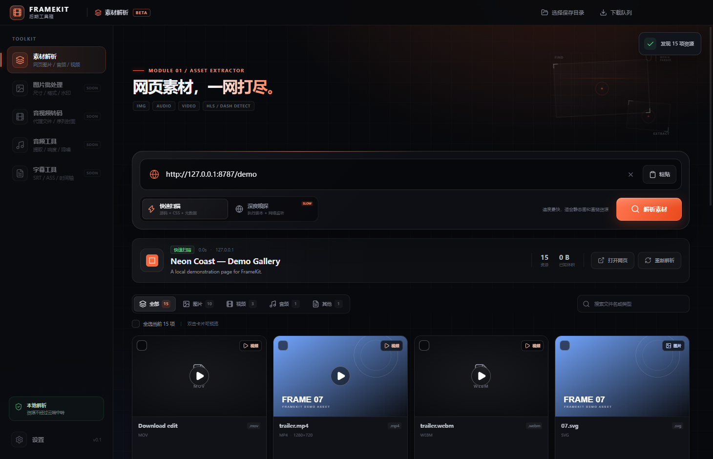
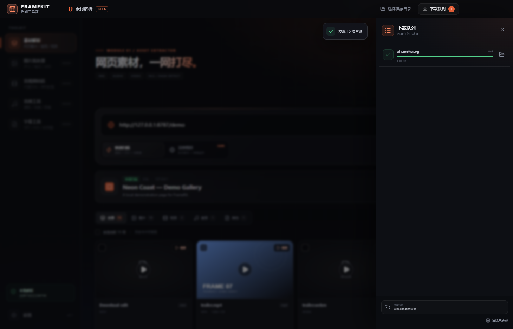

# FrameKit 后期工具箱

面向视频剪辑与后期工作者的跨平台桌面工具集。当前首个模块是**网页素材解析器**：粘贴一个网址，提取页面里可下载的图片、音频、视频、字幕与其他文件。

支持 Windows 与 macOS，基于 Electron + React + TypeScript 构建，解析与下载全部在本机完成。

当前正式版：**v1.2.0**





## 下载

- [FrameKit 1.2.0 · Windows x64 安装包](https://github.com/cola4565/framekit/releases/download/v1.2.0/FrameKit-1.2.0-Windows-x64.exe)
- [FrameKit 1.2.0 · macOS Apple Silicon](https://github.com/cola4565/framekit/releases/download/v1.2.0/FrameKit-1.2.0-macOS-arm64.dmg)
- [FrameKit 1.2.0 · macOS Intel](https://github.com/cola4565/framekit/releases/download/v1.2.0/FrameKit-1.2.0-macOS-x64.dmg)
- [全部版本与更新说明](https://github.com/cola4565/framekit/releases)

安装包暂未配置商业代码签名证书，首次运行时系统可能提示未知开发者。

## 当前能力

- **快速扫描**：读取页面 HTML，解析 `img`、`srcset`、`picture`、`video`、`audio`、`a`、`link`、Open Graph、Twitter Card、JSON-LD、内联脚本与 CSS 背景图。
- **深度嗅探**：启动隐藏的内置浏览器执行页面脚本、滚动触发懒加载，并监听真实网络请求，捕获动态插入的图片、音视频、HLS/DASH 清单和脚本请求资源。
- **统一资源库**：按图片、视频、音频、其他分类；支持搜索、筛选、尺寸/时长/体积/MIME 展示。
- **内置预览**：图片、视频、音频和流媒体清单说明；支持复制直链和浏览器打开。Bilibili 多清晰度资源预览时自动使用最低清晰度，下载仍按你选择的清晰度执行。
- **批量下载**：多选、队列并发、实时速度与进度、取消、文件名去重、Content-Disposition 文件名、`.part` 临时文件。
- **下载队列管理**：记录本地持久化，可逐条删除（同时删除磁盘文件）、清空列表、定位文件；磁盘文件被外部删除后会在队列中标记“文件已在磁盘上删除”。
- **Bilibili 专用解析**：读取账号可用的清晰度列表（含大会员 4K/1080P+ 等），分别下载独立视频流与音频流，并用内置 ffmpeg 自动合并为标准 MP4。
- **抖音专用解析**：捕获 DASH（Dynamic Adaptive Streaming over HTTP，动态自适应流媒体）视频流与独立音频流，按会话参数配对后用内置 ffmpeg 自动合并为标准 MP4；需要登录时可在应用内完成抖音登录。
- **爱给网专用解析**：搜索页读取公开低清预览；条目页通过站点正常登录流程读取 1080P/720P 等下载规格。未登录或权限不足时只保留公开预览，不绕过登录、验证码、会员或付费限制。
- **应用内更新检查**：右上角“检查更新”读取 GitHub 最新正式版，比较版本并直达对应平台的安装包。
- **后台运行**：关闭窗口时选择最小化到系统托盘 / 菜单栏，下载任务继续执行；托盘右键可直接退出。
- **跨平台打包**：Windows NSIS（Nullsoft Scriptable Install System，安装包制作系统）安装包与 macOS DMG（Apple Disk Image，苹果磁盘映像）配置；应用图标已生成。
- **轻量构建与清理**：构建前自动删除旧 `out/`、`release/`；运行时只清理 Electron 缓存目录，保留 Cookie、Local Storage（本地存储）、下载历史和用户素材。

> 请只下载和使用你有权访问、保存的内容，并遵守目标网站的服务条款与版权要求。

## 使用方式

1. 打开应用，点击右上角“选择保存目录”。
2. 粘贴网页地址。
3. 默认使用“快速扫描”；如果页面由 JavaScript 动态加载，切换到“深度嗅探”。
4. 在结果中筛选、预览、勾选素材，然后下载。
5. 下载进度和文件位置在右上角“下载队列”中查看。
6. 点击右上角“检查更新”，可查看 GitHub 上的最新正式版与更新说明。

### Bilibili 说明

- 解析 Bilibili 视频页时会显示当前账号可用的全部清晰度，每个清晰度是一条独立资源。
- Bilibili 的视频流与音频流是分离的，下载时应用会分别下载并自动合并为带声音的 MP4；预览也会同时播放独立音轨。
- 需要大会员清晰度时，点击网址旁的“登录 B站”，在内置窗口完成登录即可，登录状态会保存在本机。
- 未登录时只能看到游客清晰度（通常是 480P / 360P）。

### 抖音说明

- 抖音网页通常把视频流与音频流分开传输，应用会按同一播放会话的 `l` 参数配对，下载完成后自动合并为标准 MP4。
- 如果视频要求登录、验证码或账号权限，点击网址旁的“登录抖音”，在内置窗口完成站点正常登录后重新解析。
- 应用不会破解 DRM（Digital Rights Management，数字版权管理）、私密作品权限或地区限制。

### 爱给网说明

- 搜索结果页只公开 300×168 等低清预览片段；完整原片需要打开条目页，并按爱给网正常流程登录。
- 条目页会显示站点提供的下载规格，例如 `1080P · 1920 x 1080 · 11m`、`720P · 1280 x 720 · 269k`。
- 点击网址旁的“登录爱给网”，在内置窗口完成登录后重新解析，即可尝试通过站点下载入口读取原片地址。
- 某些清晰度、源文件或商用授权可能需要 VIP（会员）、铜币或单独授权；应用会跳过被站点拦截的规格并给出提示。
- 官方 API（Application Programming Interface，应用程序接口）只覆盖获授权的资源范围，不等于页面所有资源都能下载；详见 [`docs/PLATFORM-NOTES.md`](docs/PLATFORM-NOTES.md)。

### 深度嗅探说明

深度嗅探使用独立的临时浏览器会话，通常需要 5–15 秒：

- 会执行页面脚本并滚动页面，触发懒加载内容。
- 会监听图片、媒体与脚本发起的网络请求。
- 不共享你日常浏览器的登录状态；需要登录才能看到的资源，当前版本无法直接读取。
- 不会绕过 DRM、付费墙或站点访问控制。

## 支持与边界

| 类型 | 支持情况 |
| --- | --- |
| 常规图片 | 支持 ``、`srcset`、懒加载属性、CSS 背景、OG/Twitter、JSON-LD、脚本内 URL |
| 常规音视频 | 支持 `<video>`、`<audio>`、`<source>`、直链、网络请求捕获 |
| HLS / DASH | 能识别 `.m3u8` / `.mpd` 清单；Bilibili DASH 已支持下载后自动合并音视频，其他站点的分片合并尚未支持 |
| 防盗链资源 | Bilibili 直链已处理 Referer / Range / Cookie；其他站点仍可能拒绝 |
| 登录后资源 | 深度嗅探使用独立会话，不继承浏览器登录状态 |
| Bilibili | 已内置专用解析，支持登录、清晰度选择与音视频自动合并 |
| 抖音 | 已内置专用解析，支持登录、DASH 音视频捕获与自动合并 |
| 爱给网 | 已内置专用解析；搜索页提供公开预览，条目页按登录与会员权限读取原片 |
| YouTube 等流媒体站 | 尚未内置专用解析器；需要后续接入 yt-dlp 类适配器 |
| 加密流媒体 | 不做 DRM 解密 |

## 开发环境

- Node.js `^20.19.0` 或 `>=22.12.0`
- npm 10+
- Windows 或 macOS

```powershell
npm install
npm run dev
```

如果 Electron 二进制下载被网络拦截，可使用镜像：

```powershell
$env:ELECTRON_MIRROR = "https://npmmirror.com/mirrors/electron/"
node node_modules/electron/install.js
```

## 测试

```powershell
# 静态解析：DOM、srcset、OG、JSON-LD、脚本、CSS、直接媒体地址
npm run test:parser

# 多文件下载、进度回调、Content-Disposition 文件名
npm run test:download

# 版本号归一化、语义化版本比较、预发布版本排序
npm run test:update

# 动态资源嗅探（需要 Electron 图形环境）
npm run test:deep

# 真实 Bilibili 解析 + 下载 + 音视频合并校验（需要网络，可能需登录）
npm run test:bilibili
```

界面自动化测试需要三个终端：

```powershell
# 终端 1：本地演示页面
npm run demo

# 终端 2：带本地调试端口的开发版
$env:FRAMEKIT_DEBUG_PORT = "9222"
npm run dev

# 终端 3：自动填写网址、解析、检查卡片、下载并截图
npm run test:ui
```

截图输出到 `.tmp/ui-results.png` 与 `.tmp/ui-queue.png`。

项目架构、约定、已知问题与发版步骤见 [`AGENTS.md`](AGENTS.md)；完整发版命令与排障见 [`docs/MAINTAINER.md`](docs/MAINTAINER.md)。

## 构建安装包

```powershell
# 仅编译
npm run build

# Windows NSIS 安装包
npm run dist:win

# macOS DMG（建议在 macOS 上执行）
npm run dist:mac
```

构建产物位于 `release/`。

`npm run build` 会先执行 `scripts/clean-build.mjs`，删除旧的 `out/` 与 `release/`，避免旧产物、旧语言包或已移除依赖残留到新安装包。安装包只保留当前版本产物。

macOS 的 DMG 打包、签名与公证需要在 macOS 上完成。当前配置未包含 Apple Developer 签名证书；正式分发前需配置 `CSC_LINK`、`CSC_KEY_PASSWORD` 与公证凭据。

## 发布与更新

应用通过 GitHub Releases API 读取仓库的 `latest` 正式版，不依赖私有服务器。

发布新正式版的流程：

1. 更新版本号：`npm version 1.1.0 --no-git-tag-version`
2. 提交代码并推送。
3. 在本机构建 Windows 安装包：`npm run dist:win`。
4. 创建并推送 `v1.1.0` 标签，或先在 GitHub 创建同标签的 Release，并手动上传 Windows 安装包。
5. `.github/workflows/release.yml` 会在 macOS 上构建 DMG 并上传到对应 Release，也可在 Actions 页面手动触发。
6. 客户端点击“检查更新”即可发现新版本并打开安装包下载。

更新检查只读取公开的 Release 元数据，不会上传任何本地素材、网址或使用记录。

## 架构

```text
electron/
  main.ts          主进程、窗口、菜单、IPC 注册
  updater.ts       GitHub Releases 版本检查与平台安装包选择
  parser.ts        快速扫描与深度嗅探的编排、结果合并
  extractor.ts     静态 HTML/CSS/脚本/元数据解析
  sniffer.ts       隐藏浏览器、DOM 快照、网络请求捕获
  bilibili.ts      Bilibili 会话、登录、清晰度与音轨匹配
  douyin.ts        抖音会话、登录、DASH 流捕获与音视频配对
  aigei.ts         爱给网会话、登录、规格读取与下载入口
  downloader.ts    下载队列、进度、命名、落盘
  media-protocol.ts framekit-media:// 预览代理
  cache-cleanup.ts 仅清理 Electron 缓存，保留登录与用户数据
  preload.ts       受限 IPC API 暴露
src/
  App.tsx          主界面与交互状态
  components/      资源卡片、预览、下载抽屉、更新弹窗、侧栏
  shared/          跨进程类型、版本比较与格式化工具
scripts/           解析、下载、动态嗅探、UI 自动化测试、构建清理
assets/            应用图标
docs/              界面截图
```

主窗口启用 `contextIsolation`、`sandbox`，关闭 `nodeIntegration`。深度嗅探窗口禁止弹窗、下载和非 HTTP(S) 导航，并拒绝所有权限请求。

## 后续模块

- 图片批处理：批量尺寸、格式转换、水印、色彩空间
- 音视频转码：代理文件、H.264/H.265、ProRes、序列封面
- 音频工具：提取、响度标准化、降噪、波形
- 字幕工具：SRT/ASS/VTT 转换、时间轴校正、翻译
- HLS/DASH 合并与 yt-dlp 适配器
- 登录态嗅探、Cookie 导入、下载断点续传
